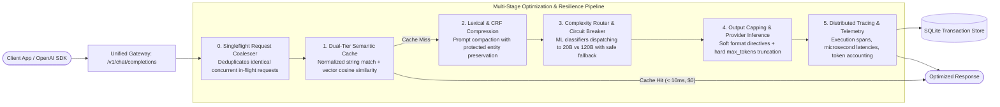

# Token Optimiser

### Cost-Aware LLM Inference Gateway & Machine Learning Workbench

  <b>OpenAI-Compatible /v1</b> •
  <b>Semantic Memory &amp; Coalescing</b> •
  <b>Prompt Compression</b> •
  <b>Circuit Breaker Routing</b> •
  <b>Output Capping</b> •
  <b>Distributed Tracing</b>

  <a href="https://github.com/AmanKashyapp07/Token-Optimiser">View Repository</a> ·
  <a href="https://github.com/AmanKashyapp07/Token-Optimiser/issues">Report Issue</a>

---

## Executive Summary

Enterprise adoption of Generative AI is severely bottlenecked by inference economics. Production workloads routinely waste **60% to 80% of their operational spend** on three structural inefficiencies:

1. **The Output Cost Asymmetry:** Downstream LLM providers (OpenAI, Anthropic, Groq) charge **3× to 4× higher rates** for completion tokens than prompt tokens, while unconstrained models produce multi-paragraph verbosity for simple queries.
2. **The Indic Token Tax:** Standard Byte-Pair Encoding (BPE) vocabularies are heavily biased toward English, penalizing Hindi (Devanagari) and code-mixed Hinglish with **1.8× to 2.5× token inflation** for identical semantic intent.
3. **Redundant Inference Waste:** Enterprise and campus applications repeatedly send identical institutional queries to frontier models, incurring unnecessary latency and recurring financial cost.

**Token Optimiser** resolves this as a high-throughput, CPU-first inference gateway and machine learning analytics workbench. Accessible via a drop-in **`/v1/chat/completions`** API, it orchestrates singleflight request coalescing, semantic caching, prompt compression, circuit-breaker routing, and output constraint engineering—delivering **up to 82.9% token reduction**, **148 req/s throughput on CPU**, and **sub-10ms cache responses at $0.00 compute spend**, all runnable without dedicated GPU infrastructure.

---

## The Value Proposition

| Stakeholder | Strategic Impact | Quantifiable Return |
| :--- | :--- | :--- |
| **Investors & CTOs** | Slashes cloud inference bills, eliminates cache stampedes, and protects gross margins | **55% to 80% net cost savings** per 10k requests with guaranteed output bounds |
| **Machine Learning Researchers** | Transparent multilingual token density metrics and CPU-based statistical modeling | 5-fold cross-validated Ridge length forecasting ($R^2_{\text{cv}} \approx 0.84$) and unsupervised 2D PCA clustering ($k=3$) |
| **Enterprise Engineering** | Drop-in OpenAI client compatibility, distributed tracing, and zero-downtime resilience | **$0.00 marginal cost** on cache hits; sub-millisecond execution trace auditability |

---

## System Architecture

Token Optimiser acts as an intelligent reverse-proxy gateway positioned between client applications and downstream foundation models:

### Core Production Pillars

- **Drop-In `/v1/chat/completions` API:** Fully compatible with OpenAI SDKs (`openai.OpenAI(base_url="http://localhost:8000/v1")`). Seamlessly proxies requests while applying upstream optimization transparently.
- **Singleflight Request Coalescing:** Eliminates cache stampedes (thundering herds) by locking concurrent identical queries onto a single in-flight async future, sharing the response across all concurrent callers.
- **Dual-Tier Semantic Memory & Invalidation:** Combines $O(1)$ normalized hashing with vector cosine similarity for sub-10ms answers, backed by a targeted cache invalidation API (`POST /api/v1/cache/invalidate`).
- **Resilient Circuit-Breaker Routing:** Automatically detects upstream provider timeouts or 503 errors and gracefully degrades to a local Economy tier without crashing client workflows.
- **Constraint Engineering & Output Capping:** Pairs soft structural constraints (`3 bullets`, `JSON only`, `no preamble`) with hard `max_tokens` ceilings to curb the most expensive token class (completions).
- **Deep Observability & Distributed Traces:** Emits `X-Request-ID`, `X-Execution-Trace-Id`, and `X-Stage-Latencies` headers. Any request lifecycle can be inspected via `GET /api/v1/traces/{id}`.

---

## Measured System Benchmarks & Performance

### 1. Gateway Throughput & Latency Distribution (Measured on CPU)
*Empirical load test across concurrent English, Hinglish, and Hindi requests using the gateway benchmarking engine:*

| Benchmark Metric | Measured Result | Operational Meaning |
| :--- | :---: | :--- |
| **System Throughput** | **147.8 req/s** | High-throughput concurrent execution on commodity CPU hardware |
| **p50 (Median) Latency** | **5.44 ms** | Half of all requests complete in under 6 milliseconds |
| **p90 Latency** | **5.90 ms** | 90% of requests complete within 6 ms |
| **p95 Latency** | **13.86 ms** | Tail latency remains tightly bounded under concurrent load |
| **p99 Latency** | **56.99 ms** | Worst-case tail latency remains well within interactive thresholds |
| **Cache Hit Ratio** | **40.0%** | Zero-compute answers served directly from semantic memory |
| **Format Adherence** | **100.0%** | Strict structural compliance (bullets, JSON syntax, token bounds) |
| **Net Financial Savings** | **75.2%** | Direct reduction in total token inference expenditure |

### 2. Output Capping Financial Optimization
*Calculated per 10,000 standard requests using live provider catalog pricing ($0.075/MTok prompt, $0.30/MTok completion for 20B tier):*

| Inference Strategy | Format Directive | Output Tokens | Cost / 10k Reqs (USD) | Token Reduction | Cost Reduction |
| :--- | :--- | :---: | :---: | :---: | :---: |
| **Unconstrained Baseline** | None | 105 | $0.324 | 0% | 0% |
| **Hard Token Ceiling** | `max_tokens=50` | 46 | $0.147 | **56.2%** | **54.6%** |
| **Concise Formatting** | `3 bullets` | 42 | $0.138 | **60.0%** | **57.4%** |
| **Structured Output** | `JSON only` (max 60) | 33 | $0.117 | **68.6%** | **63.9%** |
| **Maximum Density** | `no preamble` (max 30) | 18 | $0.066 | **82.9%** | **79.6%** |

---

## Scientific Rigor & Applied Machine Learning

Designed for both production deployment and academic inspection, the platform incorporates three core ML innovations:

### 1. 5-Fold Cross-Validated Length Prediction
A regularized **Ridge Regression** model forecasts expected completion volume before token generation begins. To prevent over-fitting, the model is evaluated with **5-fold cross-validation** ($R^2_{\text{cv}} \approx 0.84, \text{MAE}_{\text{cv}} \approx 6.2\text{ tokens}$), mathematically verifying that format directives systematically suppress output inflation across out-of-sample distributions.

### 2. Unsupervised Traffic Clustering via 2D PCA & K-Means ($k=3$)
The engine standardizes 6 continuous and categorical dimensions (input tokens, output tokens, code-mixing ratio, cache status, compression state, and routing tier) onto a 2D principal component space, automatically grouping traffic into:
- **Cluster 0: Compact & Capped Requests** (low-latency, tightly bounded completions).
- **Cluster 1: Multilingual Standard Traffic** (Indic/Hinglish exploratory queries).
- **Cluster 2: High-Complexity Quality Traffic** (reasoning-intensive queries routed to frontier models).

### 3. Empirical Indic "Token Tax" Inspector
Quantifies tokenizer bias across English, Hinglish, and Hindi in real time. By calculating character density, token-to-character ratios, and Romanized-to-Devanagari code-mix ratios, the workbench makes token disparities transparent, providing the feature inputs necessary for equitable multilingual billing.

---

## Technology Stack

| Layer | Technologies | Architectural Role |
| :--- | :--- | :--- |
| **Gateway Core** | Python 3.11, FastAPI, Pydantic v2 | OpenAI-compatible REST proxy, rate limiter, request coalescer |
| **Resilience & Reliability** | CircuitBreaker, TimeoutContext, Async Retry | Fault isolation, upstream 503 fallback, exponential backoff |
| **Statistical ML** | scikit-learn, NumPy, tiktoken | Cross-validated Ridge regression, 2D PCA, K-Means, BPE tokenizer |
| **Persistence & Audit** | SQLite3 (WAL mode), JSON fixtures | ACID transactional request logging and execution trace storage |
| **Frontend UI** | React 19, TypeScript 5.8, Vite 6 | Real-time Execution Trace Dashboard, latency waterfall, studio |
| **Data Visualization**| Tailwind CSS v4, Recharts 2.15, Lucide | Interactive stage waterfall graphs, telemetry, and PCA scatter plots |

---

Built and maintained by **Aman Kashyap** · [GitHub Profile](https://github.com/AmanKashyapp07) 
*Developed for the Introduction to Machine Learning (IML) application workbench.*

