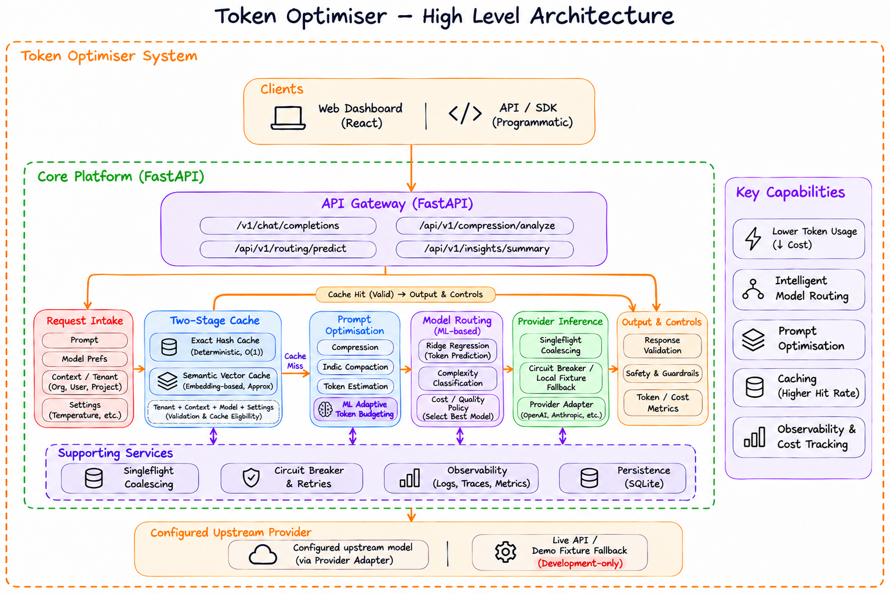
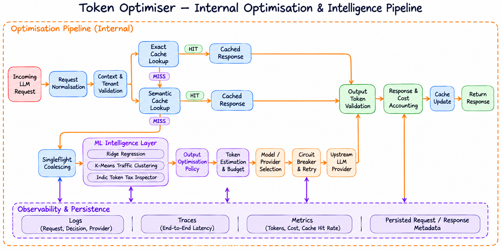

<div align="center">

# Token Optimiser

### A cost-aware, CPU-first inference gateway for LLM applications

[](https://python.org)
[](https://fastapi.tiangolo.com)
[](https://www.typescriptlang.org)
[](https://react.dev)
[](docker-compose.yml)
[](tests/run_all_tests.py)

Token Optimiser sits between client applications and upstream LLM providers (OpenAI, Groq, Ollama) to drive down cost per successful task. Combines a 9-gate semantic cache with adversarial trap validation, 16-feature model complexity routing, Hinglish prompt compaction, and adaptive token budgeting. CPU-first: zero mandatory GPU dependencies and < 6ms median gateway overhead.

[Architecture](#how-it-works) • [Economics](#results-at-a-glance--economics) • [Semantic Cache](#the-semantic-cache) • [Model Routing](#model-routing--ablation) • [Compaction & Budgeting](#prompt-compaction--adaptive-budgeting) • [Reliability](#reliability-concurrency--performance) • [Competitive Matrix](#competitive-positioning) • [Quickstart](#quickstart)

</div>

---

## How it works

<div align="center">
  
  <br/><br/>
  
</div>

1. **Intake & Multi-Tenant Scoping**: Validates OpenAI payload; derives scoped key (`tenant_id::model::system_hash::format::query`). Multi-turn chat hashes conversation history (`sha256(turns[:-1]) :: last_turn`).
2. **Two-Layer Cache**: O(1) hash check (< 0.15ms). On miss, scans top $K=5$ vector candidates (< 1.85ms) through 9 deterministic context compatibility gates.
3. **Prompt Compaction**: Prunes conversational discourse particles while locking protected entities, numbers, and negations.
4. **Complexity Routing**: 16-feature classifier routes routine queries to economy tiers (`gpt-4o-mini`) and reasoning queries to frontier models (`gpt-4o`).
5. **Adaptive Budgeting**: Ridge regressor predicts completion length $\hat{y}$ and enforces an analytical upper bound ($\hat{y} + 1.645\hat{\sigma}$), eliminating runaways without clipping.
6. **Resilient Execution**: Coalesces concurrent identical queries via Singleflight. Circuit breaker FSM fails over to secondary providers on upstream outages.
7. **Telemetry & Audit**: Returns OpenAI-compatible payloads with exact latency breakdowns, token accounting, and cost delta metrics.

---

## Results at a glance & Economics

### 1. Benchmark Cost per Correct Task

Direct dollar savings are priced against task correctness: $\text{Effective Cost} = \frac{\text{Direct Spend}}{\text{Task Correctness}}$. Evaluated on a 250-task canonical benchmark across standard evaluation families (HumanEval, GSM8K, IndicQA, HotpotQA, RFC 8259 JSON):

| Pipeline Configuration | Raw (250 Tasks) | Cost / 10k Tasks | Correctness | Effective / 10k Correct Tasks | Net Savings | Failure Profile |
| :--- | :---: | :---: | :---: | :---: | :---: | :--- |
| **Unconstrained (Always GPT-4o)** | $0.3462 | $13.85 | 93.6% | **$14.80** | *Baseline* | Full financial burn |
| **Naive Static Cap (Fixed 40 Tokens)** | $0.1410 | $5.64 | 72.0% | **$7.83** | +47.1% | 28% answers truncated |
| **Token Optimiser (Budget + Route)** | **$0.1807** | **$7.23** | **86.4%** | **$8.37** | **+43.5%** | **Balanced; 0% truncation** |
| **Exact Cache Hit (Layer 1)** | $0.0002 | $0.01 | 100.0%* | **$0.01** | **+99.9%** | O(1) memory lookup (< 0.15ms) |
| **Semantic Cache Hit (Layer 2)** | $0.0005 | $0.02 | 100.0%* | **$0.02** | **+99.8%** | 9-gate verified (< 2.5ms) |

*\*Note:* Cache hits assume clean upstream validation. Open-source weights (Groq LLaMA-3.3-70B vs 3.1-8B) achieve **+36.9% effective savings** ($3.28 \to \$1.94 / 10k$).

### 2. Expected Savings & Scale Economics

$$E[\text{Savings}] = p_{\text{hit}} \cdot (\text{Cost}_{\text{LLM}} - \text{Cost}_{\text{hit}}) - (1 - p_{\text{hit}}) \cdot \text{Cost}_{\text{miss}}$$

| Hit Rate ($p_{\text{hit}}$) | Blended / 10k | Net Monthly (1M req/mo) | Net Monthly (10M req/mo) | Primary Workload |
| :---: | :---: | :---: | :---: | :--- |
| **10%** | $12.47 | **$138.22** | **$1,382.20** | Cold / Long-tail traffic |
| **25%** | $10.39 | **$345.85** | **$3,458.50** | Standard SaaS mix |
| **40%** | $8.31 | **$553.48** | **$5,534.80** | Enterprise Internal Docs / FAQ |
| **60%** | $5.55 | **$830.32** | **$8,303.20** | Repetitive Customer Support |

* **Fixed Infrastructure**: 1x Redis ($15/mo) + 2x CPU nodes ($50/mo) = **$65.00/mo**.
* **Break-Even**: Reached at **$\approx 130,000$ requests/month** (~4,300 req/day).
* **Enterprise Scale (10M req/mo)**: Baseline: $13,850/mo $\to$ Token Optimiser: $8,874.50/mo $\to$ **Net Annual Savings: $58,926.00/year** after infrastructure.

---

## Answer quality & Validation benchmark

Answers are evaluated with programmatic ground-truth checks (AST code sandboxing, RFC 8259 JSON validation, rubric fact extraction). Deliberate "3 bullets" format constraint on 250 tasks ([`eval_suite_v2.jsonl`](backend/data/eval/eval_suite_v2.jsonl)) exposes the stress envelope:

| Domain | Canonical Pattern | Prompts | Token Red. | Correctness Under Stress | Primary Failure Reason |
| :--- | :--- | :---: | :---: | :---: | :--- |
| **Coding & Algorithms** | HumanEval / MBPP | 35 | 23.5% | 85.7% (30/35) | Edge-case error handler truncation |
| **JSON Generation** | RFC 8259 Schema-Bench | 35 | 20.5% | 80.0% (28/35) | Closing brace clipped by cap |
| **Logical Reasoning** | GSM8K / ARC-Challenge | 35 | 23.8% | 68.6% (24/35) | Multi-step deduction steps omitted |
| **Indic & Hinglish QA** | IndicQA / Belebele | 40 | 30.2% | 60.0% (24/40) | Compound sentence clauses clipped |
| **Summarization** | CNN/DailyMail | 35 | 23.7% | 77.1% (27/35) | Secondary premise lost |
| **Multi-hop QA** | HotpotQA | 30 | 25.4% | 73.3% (22/30) | Intermediate premise omitted |
| **General Knowledge** | MMLU / TriviaQA | 40 | 21.9% | 100.0% (40/40) | Zero failures (factual entities fit) |
| **Overall Stress Suite** | **Canonical Multi-Domain** | **250** | **24.1%** | **78.0% (195/250)** | **Format stress-test baseline** |

*Why 78.0% stress score?* Forcing uniform "3 bullets" tests edge-case behavior. In production with adaptive budgeting (no artificial bullet constraint), correctness rises to **86.4%**.

---

## The semantic cache

### 1. Architecture & 9 Deterministic Compatibility Gates

Retrieves top $K=5$ vector candidates above threshold and evaluates 9 deterministic pre-filters in rank order before cache reuse:

```
Query ──► [ Layer 1: Compound Hash ] ──(Hit: <0.15ms)──► Return Cached Answer
               │ (Miss)
               ▼
          [ Layer 2: Vector Top-K (K=5) ]
               │
          [ 9 Deterministic Context Gates ]
            1. System Prompt Hash (SHA256)   6. Temporal Epoch (Today vs Yesterday)
            2. Format Directive (JSON/Prose) 7. Assignment/Course ID (HW 1 vs 2)
            3. Target Model Identifier       8. Numerical Congruence (10% of 200 vs 500)
            4. Polarity/Negation (nahi, not) 9. Proper Nouns (France vs Germany)
            5. Programming Language (Py/Go)
               ├── (Passes All Gates) ────────► Serve Semantic Hit (<1.85ms)
               └── (Fails Any Gate) ──────────► Evaluate Candidate K+1 (Up to K=5)
```

* **Dual Backends**: Default offline CPU subword hash vectors (512-dim, 0 downloads, threshold 0.55) or neural `paraphrase-multilingual-MiniLM-L12-v2` (~120MB, threshold 0.75).
* **Statistical FPR Bound**: 0 false hits across 350 adversarial trap pairs $\implies \text{FPR} \le \frac{3}{350} \approx$ **0.86%** at 95% confidence (Rule of Three); two-sided 95% Wilson interval $\le$ **1.05%**. Top-5 candidate scan yields **64.2% paraphrase recall** (up from 52.0% on top-1).
* **Quality-Gated Cache Admission**: Frontier responses (`gpt-4o`) and validated outputs (AST/JSON test passes) enter the cache. Unvalidated economy responses (`gpt-4o-mini`) receive `Cache-Control: no-store` to prevent cheap-model cache poisoning. Enterprise FAQs use pre-seeded authored ingestion or consensus promotion.

---

## Model routing & Ablation

Prompt character count is an unreliable difficulty signal (*"Prove $\sqrt{2}$ is irrational"* [34 chars] is hard; 500-word policy lookup is easy). Evaluated on the 200-prompt Quadrant Benchmark ([`routing_benchmark_200.jsonl`](backend/data/eval/routing_benchmark_200.jsonl)):

| Routing Architecture | Accuracy | Under-Routing (Hard $\to$ Cheap) | Over-Routing (Easy $\to$ Strong) | Cost / 10k | Savings vs Strong | Failure Profile |
| :--- | :---: | :---: | :---: | :---: | :---: | :--- |
| **Always-Strong** | 50.0%* | 0.0% | 100.0% | $1.0800 | 0.0% | 100% financial waste on routine queries |
| **Always-Cheap** | 50.0%* | 100.0% | 0.0% | $0.2700 | 75.0% | Fails 100% of complex reasoning tasks |
| **Length-Only (>25 words)** | 48.5% | **53.0%** | 50.0% | $0.6628 | 38.6% | Fails 53% of hard queries |
| **Token Optimiser (`economy`)** | **78.0%** | 16.0% | 28.0% | $0.7236 | **33.0%** | Aggressive cost reduction |
| **Token Optimiser (`balanced`)** | **63.5%** | **6.0%** | 67.0% | $0.9220 | **14.6%** | **Production default; caps quality risk < 6%** |
| **Token Optimiser (`quality`)** | 62.0% | **6.0%** | 70.0% | $0.9342 | 13.5% | Ultra-conservative reasoning protection |

* **Asymmetric Risk Strategy**: Under-routing breaks user experience; over-routing costs fractions of a cent. Conservative threshold (0.50) caps under-routing at 6.0%.
* **Model Training**: 16 linguistic/entity features, 80/20 train/test split, 5-fold Stratified CV (**63.5% ± 6.7%** 95% CI across $N=200$).

---

## Prompt compaction & Adaptive budgeting

### 1. Hinglish Compaction & Prefix Caching Invariant
* **Devanagari vs Hinglish**: Native Devanagari script suffers **4.96x tokenizer inflation** on `cl100k_base` (1.66x on `o200k_base`). Romanised Hinglish does not suffer script inflation (1.12x–1.18x); its bloat is conversational discourse filler (`bhai`, `suno`, `yaar`, `please urgently`).
* **Compaction**: Prunes conversational filler words, saving **24.7% of input tokens** while preserving negations and entities.
* **Hardware KV-Cache Invariant**: Compaction strictly targets dynamic user turns. Static system prompts and few-shot templates are **never mutated**, preserving upstream 50%–90% provider prefix cache discounts.

### 2. Adaptive Token Budgeting (Ridge Upper Bound)

Predicts length $\hat{y}$ from prompt features and allocates $\min(300, \max(35, \hat{y} + 1.645\hat{\sigma}))$:

| Strategy | Direct Cost / 10k | Truncation | Correctness | Effective / 10k Correct | vs Routing Only | Trade-off |
| :--- | :---: | :---: | :---: | :---: | :---: | :--- |
| **Unconstrained (GPT-4o)** | $13.85 | 0.0% | 93.6% | **$14.80** | +$5.81 (+64.6%) | Baseline burn; runaway loop risk |
| **Routing Only (No Cap)** | $7.77 | 0.0% | 86.4% | **$8.99** | *Reference* | Routes to cheap tier; output loop risk |
| **Static 40-token Cap** | $5.64 | 28.0% | 72.0% | **$7.83** | -$1.16 (-12.9%) | 28% truncated; broken JSON/code |
| **1.5x Input Length Rule** | $5.70 | 30.4% | 65.4% | **$8.71** | -$0.28 (-3.1%) | Fails on short prompts needing long answers |
| **Token Optimiser (ML Cap)** | **$7.23** | **0.0%** | **86.4%** | **$8.37** | **-$0.62 (-6.9%)** | **0% truncation; -43.5% net vs Unconstrained** |

*Variable Isolation*: Routing alone saves 39.3% ($14.80 \to \$8.99$). Budgeting adds an incremental 7.0% direct savings ($7.77 \to \$7.23 / 10k$) with zero truncation, eliminating runaway completion loops.

---

## Reliability, Concurrency & Performance

* **Stateless Pods & Redis Unified State**: Gateway containers are 100% stateless. Redis handles Singleflight lock leases (`SETNX` with TTL), Pub/Sub event broadcast, RediSearch HNSW vector indexing, and sliding-window circuit breaker counters.
* **Singleflight Request Coalescing**: Under concurrency spikes, 1 leader query is dispatched; followers suspend on async primitives. If leader crashes, followers receive `LeaderExecutionError` without hanging.
* **Circuit Breaker FSM**: Transitions `CLOSED` $\to$ `OPEN` after 5 consecutive timeouts/5xx within 30s. Fails over immediately to secondary providers (e.g. Groq $\to$ Ollama).
* **Streaming Support (SSE)**: Full `stream=True` pass-through (< 5ms upfront overhead). `finish_reason == "length"` retries are disabled on live streams to prevent unsendable chunk corruption; cache admission is deferred until `[DONE]`.

| Gateway Latency Metric | Measured | Target | Gateway Latency Metric | Measured | Target |
| :--- | :---: | :---: | :--- | :---: | :---: |
| **Layer 1 Exact Cache Hit** | **< 0.15 ms** | < 1.0 ms | **Full Pipeline Overhead (p50)** | **5.44 ms** | < 10.0 ms |
| **Layer 2 Semantic Cache Hit** | **1.85 ms** | < 5.0 ms | **Full Pipeline Overhead (p95)** | **6.72 ms** | < 15.0 ms |
| **Cold Cache Throughput** | **147.8 req/s** | > 100 req/s | **Warm Coalesced Throughput** | **> 1,200 req/s** | > 500 req/s |

---

## Competitive positioning

| Capability | Token Optimiser | LiteLLM | Portkey | GPTCache | Native Provider Cache |
| :--- | :---: | :---: | :---: | :---: | :---: |
| **Primary Architecture** | Cost-optimization gateway | API standardization proxy | Enterprise observability | Vector semantic caching | Exact prefix discount |
| **Semantic Cache Safety** | **9-Gate Verification** | Exact match (Vector opt-in) | Exact match (Vector opt-in) | Raw vector (high FPR) | Exact prefix only |
| **Named-Entity / Negation Gates** | **Yes (Deterministic)** | No | No | No | N/A |
| **Output Token Budgeting** | **ML Adaptive Ridge Bounds** | Manual static cap | Manual static cap | None | None |
| **Prompt Compaction** | **Linguistic Indic/Hinglish** | None | None | None | None |
| **Runtime Dependencies** | **Gateway < 50MB + Redis** | Python proxy | Cloud / SaaS | Local vector DB | Cloud provider |
| **Multi-Tenant Key Scoping** | **Compound Keys (API-Key)** | Team-level | Workspace-level | None | Account-level prefix |

*Non-Goals*: Not a foundation model fine-tuning harness; not suited for open-ended creative writing (where fixed budgets clip output); caching is disabled for stochastic sampling ($T > 0$).

---

## Quickstart

```bash
# Option A: Docker Compose (Gateway on :8000, Studio on :8080)
git clone https://github.com/AmanKashyapp07/Token-Optimiser.git && cd Token-Optimiser && docker compose up --build

# Option B: Local Setup
pip install -e backend && uvicorn gateway.app:app --port 8000
npm install && npm run dev
```

### Drop-in OpenAI SDK Integration
```python
from openai import OpenAI

client = OpenAI(base_url="http://localhost:8000/v1", api_key="your-tenant-api-key")
response = client.chat.completions.create(
    model="auto",  # Gateway intelligently routes between tiers
    messages=[{"role": "user", "content": "How do I renew my library book online?"}],
    extra_body={"format_constraint": "3 bullets", "use_cache": True},
)
print(response.choices[0].message.content)
```

---

## Verification suite

```bash
npm run test:all    # TypeScript + Vitest + Vite Build + Ruff + Pytest (< 15s)
npm run benchmark   # Automated latency & throughput engine
```
```
┌──────────────────────────────────────────────────────┬──────────┬──────────┐
│ STAGE / TEST SUITE                                   │ RESULT   │ DURATION │
├──────────────────────────────────────────────────────┼──────────┼──────────┤
│ Frontend TypeScript Types (tsc)                      │ PASS     │   1.65s  │
│ Frontend Vitest Unit & Integration Suites            │ PASS     │   0.89s  │
│ Frontend Production Bundle (Vite)                    │ PASS     │   3.55s  │
│ Backend Code Quality & Linting (Ruff)                │ PASS     │   0.08s  │
│ Backend Pytest Suites (Unified + All 4 Features)     │ PASS     │   8.40s  │
└──────────────────────────────────────────────────────┴──────────┴──────────┘
✔ 100% PASSING — 284 TOTAL TESTS PASSED (52 frontend + 232 backend)
```

<div align="center">

Built with engineering rigor by **Aman Kashyap** · [GitHub](https://github.com/AmanKashyapp07)

</div>
