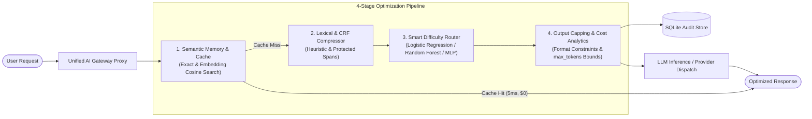

# ⚡ Token Optimiser — High-Performance LLM Gateway & Analytics

[](https://python.org)
[](https://fastapi.tiangolo.com)
[](https://www.typescriptlang.org)
[](https://react.dev)
[](https://vitejs.dev)
[](scripts/run_all_tests.py)

> **An intelligent, cost-aware AI Gateway and Analytics Workbench engineered to minimize LLM inference costs and latency across English, Hinglish, and Hindi workloads.**  
> Built with a CPU-first, deterministic pipeline featuring prompt compression, semantic caching, difficulty-aware model routing, output-capping constraint engineering, and statistical ML analytics.

---

## 🎯 The Engineering Problem

Modern enterprise applications querying commercial Large Language Models (LLMs) face three major cost and latency bottlenecks:

1. **The Output Cost Asymmetry:**  
   LLM providers (OpenAI, Groq, Anthropic) price completion tokens at **3× to 4× higher rates** than prompt tokens. Unconstrained models generate verbose, multi-paragraph answers when users only need structured or concise data.
2. **The "Token Tax" on Indic Languages:**  
   Standard Byte-Pair Encoding (BPE) vocabularies (e.g., `cl100k_base`) were trained predominantly on English corpora. In Hindi (Devanagari) and code-mixed Hinglish, words fragment into multiple byte tokens, inflating token usage by **1.8× to 2.5×** for the exact same semantic intent.
3. **Redundant Inference Spend:**  
   Common institutional queries are repeatedly re-sent to expensive frontier models instead of being intercepted by semantic memory.

---

## 🏗️ System Architecture

The gateway acts as an intelligent middleware proxy intercepting requests before they reach downstream LLMs:



---

## 🚀 Key Features & Technical Highlights

### 1. Dynamic Output Capping & Constraint Engineering (Core Ownership)
- **High Financial Leverage:** Enforces output-capping strategies (`"3 bullets"`, `"JSON only"`, `"no preamble"`, and `max_tokens` boundaries) that cut expensive completion tokens by **55% to 83%**.
- **Hard vs. Soft Bounds:** Combines soft semantic constraints (ensuring full thought coherence) with hard token limits (preventing runaway token consumption).

### 2. Multilingual Token Tax Inspector
- Real-time side-by-side analysis of Romanized English, code-mixed Hinglish, and native Devanagari Hindi.
- Computes character counts, token density, **tokens-per-character**, and **code-mixing ratios** to mathematically expose tokenizer bias.

### 3. Applied Machine Learning on CPU
- **Supervised Ridge Regression ($R^2 \approx 0.84$, $\text{MAE} \approx 6\text{ tokens}$):** Predicts expected output token lengths based on input length, language script, format constraints, and token bounds. Feature weights reveal negative coefficients for format instructions.
- **Unsupervised 2D PCA & K-Means ($k=3$):** Dimensionality reduction projecting 6 request features (input tokens, output tokens, code-mixing ratio, cache status, compression flag, routing tier) down to 2 principal components, automatically grouping traffic into *Compact/Capped*, *Standard Multilingual*, and *High-Detail Quality* profiles.

### 4. Zero-Cost Semantic Cache
- Dual-tier lookup: $O(1)$ exact normalized string match backed by an offline hash and vector embeddings for semantic similarity search.
- Returns verified FAQ answers in **< 10ms for $0.00 infrastructure cost**.

### 5. Policy-Aware Model Routing
- Evaluates linguistic complexity and routes queries between **Economy Tier** (20B small models @ `$0.075 / MTok`) and **Quality Tier** (120B large models @ `$0.15 / MTok`) under user-selected policies (`Economy`, `Balanced`, `Quality`).

---

## 📊 Quantified Cost Savings & Benchmarks

| Query Strategy | Format Constraint | Output Tokens | Tokens Saved | Cost / 10k Reqs (USD) | Savings vs. Baseline |
|---|---|:---:|:---:|:---:|:---:|
| **Unconstrained Baseline** | None | 105 tokens | 0 | **$0.324** | 0% |
| **Hard Ceiling** | `max_tokens=50` | 46 tokens | 59 tokens | **$0.147** | **56.2%** |
| **Concise Format** | `3 bullets` | 42 tokens | 63 tokens | **$0.138** | **60.0%** |
| **Structured Output** | `JSON only` (max 60) | 33 tokens | 72 tokens | **$0.117** | **68.6%** |
| **Maximum Density** | `no preamble` (max 30) | 18 tokens | 87 tokens | **$0.066** | **82.9%** |

---

## 🛠️ Technology Stack

| Layer | Technologies | Purpose |
|---|---|---|
| **Backend Services** | **Python 3.11**, **FastAPI**, **Pydantic v2** | High-performance asynchronous REST API gateway. |
| **ML & Algorithms** | **Scikit-Learn**, **NumPy**, **Tiktoken** | Ridge regression, PCA, K-Means, and BPE tokenization. |
| **Storage & Persistence** | **SQLite3** (WAL mode), JSON fixtures | Transactional audit store and curated baseline fixtures. |
| **Frontend UI** | **React 19**, **TypeScript 5.8**, **Vite 6** | Component-driven interactive dashboard with strict types. |
| **Visualization & Styling** | **Tailwind CSS v4**, **Recharts 2.15**, **Lucide Icons** | Responsive layout, theme variables, and SVG data charts. |
| **Test Engineering** | **Pytest**, **Vitest**, **Ruff** | 214 unit, integration, stress, and invariant tests. |

---

## 🧪 Comprehensive Quality & Test Verification

The repository includes a dedicated test runner validating all **214 automated tests** across the full stack in **~11 seconds**:

```bash
# Run all frontend and backend tests with formatted dashboard:
npm run test:all
# or:
./scripts/run_tests.sh
```

### Verified Test Categories:
- **Unified Pipeline Integration (`test_unified_pipeline.py`):** Simulates end-to-end multi-stage query lifecycle.
- **Robustness & Invariants (`test_unified_robustness.py`):** Enforces cost monotonicity, strict capping ceilings, safety span preservation (URLs, emails, currency), and 20-query sequential stress testing.
- **Feature Suites:** Dedicated suites for Insights & Capping (`test_insights.py`), Routing (`test_routing_*.py`), Compression (`test_compression.py`), and Cache (`test_cache.py`).
- **Frontend Type & Unit Tests:** Full Vitest test suites (`src/**/*.test.ts`) and zero-error `tsc --noEmit` check.

---

## ⚡ Quickstart Guide

### Prerequisites
- **Node.js** v20+ and **Python** 3.11+

### Installation & Setup

```bash
# 1. Clone your fork
git clone https://github.com/AmanKashyapp07/Token-Optimiser.git
cd Token-Optimiser

# 2. Run automated cross-platform setup
python scripts/setup.py

# 3. Start both backend and frontend together
npm run dev
```

Open your browser to:
- **Unified Studio Dashboard:** [http://localhost:8080](http://localhost:8080)
- **Token & Cost Insights Workspace:** [http://localhost:8080/insights](http://localhost:8080/insights)
- **Interactive Swagger API Docs:** [http://localhost:8000/docs](http://localhost:8000/docs)

---

## 📖 Presentation & Interview Guide

See [**`PRESENTATION.md`**](PRESENTATION.md) for a complete:
- 30-Second Elevator Pitch
- Click-by-click live demo script for evaluators
- Examiner Q&A cheat sheet covering tokenization mechanics, linear models, and system design trade-offs.

---

## 👤 Author & Ownership
- **Aman Kashyap** ([@AmanKashyapp07](https://github.com/AmanKashyapp07))
  - *Lead Engineer:* Output Capping Constraint Engineering, Token Tax Analysis, Financial Cost Engine, and ML Analytics (Ridge Regression, PCA, K-Means).
- *Course:* Introduction to Machine Learning (IML) Application Workbench.
