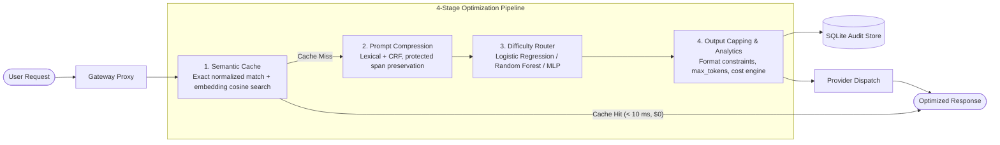

# Token Optimiser

### High-Performance LLM Gateway and Analytics Workbench

[](https://python.org)
[](https://fastapi.tiangolo.com)
[](https://www.typescriptlang.org)
[](https://react.dev)
[](https://vitejs.dev)
[](scripts/run_all_tests.py)

**Prompt Compression** • **Semantic Caching** • **Difficulty-Aware Routing** • **Output Capping** • **Multilingual Token Analytics**

[View Repository](https://github.com/AmanKashyapp07/Token-Optimiser) · [Report Issue](https://github.com/AmanKashyapp07/Token-Optimiser/issues) · [Presentation Guide](PRESENTATION.md)

---

**Token Optimiser** is a cost-aware AI gateway that reduces LLM inference cost and latency across English, Hinglish, and Hindi workloads. It sits between an application and downstream providers, running every request through a deterministic, CPU-only pipeline: semantic cache lookup, prompt compression, difficulty-aware model routing, and output capping with cost analytics.

A companion workbench exposes the same pipeline interactively, complete with a multilingual token tax inspector, a financial cost engine, and statistical machine learning analytics (Ridge Regression, PCA, K-Means) over live request traffic.

---

## Why I Built This

Commercial LLM usage carries three avoidable overheads: verbose completions, tokenizer penalty on Indic text, and repeated calls for identical questions. I built Token Optimiser to measure each of these bottlenecks and eliminate them without needing a GPU cluster or paid external infrastructure.

- **Lower Output Spend:** Completion tokens cost **3× to 4× more** than prompt tokens. Constraining output length yields the highest financial leverage in the system.
- **Fair Multilingual Cost:** Hindi and Hinglish text fragments into **1.8× to 2.5× more tokens** than equivalent English. The inspector makes that gap transparent and quantifiable.
- **No Redundant Inference:** Repeated institutional queries are answered from semantic memory in **< 10 ms at $0.00 inference cost**.
- **Deterministic and CPU-First:** Every pipeline stage runs locally on CPU and behaves predictably, keeping results testable, reproducible, and cost-free.

---

## Table of Contents

- [Core Capabilities](#core-capabilities)
- [Tech Stack](#tech-stack)
- [System Architecture](#system-architecture)
- [Deep-Dive Engineering Highlights](#deep-dive-engineering-highlights)
  * [1. Output Capping and Constraint Engineering](#1-output-capping-and-constraint-engineering)
  * [2. Multilingual Token Tax Analysis](#2-multilingual-token-tax-analysis)
  * [3. Two-Tier Semantic Cache](#3-two-tier-semantic-cache)
  * [4. Policy-Aware Model Routing](#4-policy-aware-model-routing)
  * [5. Statistical ML Analytics on CPU](#5-statistical-ml-analytics-on-cpu)
- [Benchmarks](#benchmarks)
- [Getting Started](#getting-started)
- [Testing & Quality Assurance](#testing--quality-assurance)
- [Presentation & Interview Guide](#presentation--interview-guide)

---

## Core Capabilities

### 1. Output Capping & Constraint Engineering
Layered soft format constraints (`3 bullets`, `JSON only`, `no preamble`) combined with hard `max_tokens` ceilings reduce completion tokens by **55% to 83%**.

### 2. Multilingual Token Tax Inspector
Side-by-side comparative analysis of Romanized English, code-mixed Hinglish, and native Devanagari Hindi—reporting character count, token count, tokens per character, and code-mixing ratios.

### 3. Dual-Tier Semantic Cache
Exact normalized string matching backed by vector embedding cosine similarity. Verified answers return in **under 10 ms at $0.00 inference spend**.

### 4. Prompt Compression
A lexical and CRF-based compressor shortens prompts while strictly preserving protected literals such as URLs, email addresses, and currency amounts.

### 5. Policy-Aware Routing
Dynamically routes queries between an **Economy Tier** (20B small model) and a **Quality Tier** (120B frontier model) under user-selected policies (`Economy`, `Balanced`, `Quality`).

### 6. Statistical ML Analytics
Lightweight supervised Ridge Regression predicts expected completion lengths, while 2D PCA with K-Means ($k=3$) automatically segments traffic into interpretable behavioral profiles.

---

## Tech Stack

| Layer | Technologies | Key Highlights |
| :--- | :--- | :--- |
| **Backend** | Python 3.11, FastAPI, Pydantic v2 | High-concurrency async REST API gateway |
| **ML & Algorithms** | scikit-learn, NumPy, tiktoken | Ridge regression, PCA, K-Means, BPE tokenization |
| **Storage** | SQLite (WAL mode), JSON fixtures | ACID-compliant transaction logs & curated benchmarks |
| **Frontend** | React 19, TypeScript 5.8, Vite 6 | Strict type-safety, component modularity |
| **Visualization** | Tailwind CSS v4, Recharts 2.15, Lucide | Responsive UI, interactive SVG charts & scatter plots |
| **Testing** | Pytest, Vitest, Ruff | 214 automated unit, integration, and stress tests |

---

## System Architecture

### Request Lifecycle Pipeline



---

## Deep-Dive Engineering Highlights

### 1. Output Capping and Constraint Engineering

```
[Prompt] ──► [Soft constraint: "3 bullets" / "JSON only" / "no preamble"]
                          │
                          ▼
             [Hard ceiling: max_tokens bound] ──► [Bounded completion]
```

#### The Problem: Output Cost Asymmetry
Providers price completion tokens **3× to 4× higher** than prompt tokens. Unconstrained models return multi-paragraph answers when the user only needed concise or structured data, causing the vast majority of infrastructure spend to go toward the most expensive token class.

#### The Solution: Layered Soft and Hard Bounds
- **Soft constraints** steer the completion structure (`3 bullets`, `JSON only`, `no preamble`) so the model finishes a complete, coherent thought within a tight token budget.
- **Hard ceilings** (`max_tokens`) guarantee that runaway generations can never exceed the designated boundary.

**Result:** Completion tokens drop from 105 to between 18 and 46 tokens per query—a **56% to 83% reduction** (see [Benchmarks](#benchmarks)).

---

### 2. Multilingual Token Tax Analysis

```
English (Romanized)  ──┐
Hinglish (code-mixed) ─┼──► [Tokenizer] ──► tokens, chars, tokens/char, mixing ratio
Hindi (Devanagari)   ──┘
```

#### The Problem: Tokenizer Bias
Byte-Pair Encoding (BPE) vocabularies such as `cl100k_base` are trained predominantly on English text. Devanagari characters and code-mixed scripts fragment into multiple byte-level tokens, making the exact same semantic intent cost **1.8× to 2.5× more**.

#### The Solution: Transparent Token Analytics
The inspector tokenizes equivalent text across all three forms in real time and reports character count, token density, tokens per character, and code-mixing ratios. These metrics also serve as feature inputs for downstream model routing and length estimation.

---

### 3. Two-Tier Semantic Cache

```
Request ──► [Tier 1: Normalized exact match, O(1)] ──Hit──► Cached Answer ($0)
                     │ Miss
                     ▼
            [Tier 2: Embedding cosine search]      ──Hit──► Cached Answer ($0)
                     │ Miss
                     ▼
              Continue Gateway Pipeline
```

#### The Problem: Redundant Inference Spend
Common organizational queries (e.g., campus policies, IT setups, deadlines) are repeatedly sent to frontier LLMs even though verified answers already exist.

#### The Solution: Dual-Tier Retrieval
An $O(1)$ normalized string match handles verbatim queries, backed by an offline hash and vector embeddings for semantically equivalent paraphrases.

**Result:** Cache hits return in **under 10 ms at $0.00 inference cost**.

---

### 4. Policy-Aware Model Routing

```
[Complexity Score] + [Policy: Economy | Balanced | Quality]
          │
          ▼
   Economy Tier (20B, $0.075 / MTok)   or   Quality Tier (120B, $0.15 / MTok)
```

#### The Problem: One Model for Every Query
Sending simple, rote queries to a large frontier model wastes token budgets, while sending complex reasoning tasks to a small model compromises answer quality.

#### The Solution: Difficulty Scoring with Policy Overrides
The router evaluates linguistic complexity using trained classifiers (Logistic Regression, Random Forest, MLP), then maps the difficulty score against the user's active policy threshold (`Economy`, `Balanced`, or `Quality`).

---

### 5. Statistical ML Analytics on CPU

```
Request Features (6) ──► PCA (2 components) ──► K-Means (k=3) ──► Traffic Profiles
```

- **Supervised Ridge Regression ($R^2 \approx 0.84, \text{MAE} \approx 6\text{ tokens}$):** Predicts expected output length from input tokens, language script, format constraints, and hard ceilings. Feature coefficients confirm that format instructions systematically suppress output length.
- **Unsupervised 2D PCA & K-Means ($k=3$):** Standardizes six request dimensions (input tokens, output tokens, code-mixing ratio, cache status, compression flag, routing tier) onto two principal components, grouping traffic into *Compact/Capped*, *Standard Multilingual*, and *High-Detail Quality* profiles.

---

## Benchmarks

*Metrics calculated per 10,000 requests. Token reduction is measured on completion tokens; cost reduction is computed using standard catalog rates.*

| Strategy | Constraint | Output Tokens | Cost (USD) | Token Reduction | Cost Reduction |
| :--- | :--- | :---: | :---: | :---: | :---: |
| **Baseline** | None | 105 | $0.324 | 0% | 0% |
| **Hard Ceiling** | `max_tokens=50` | 46 | $0.147 | **56.2%** | **54.6%** |
| **Concise Format** | `3 bullets` | 42 | $0.138 | **60.0%** | **57.4%** |
| **Structured Output** | `JSON only` (max 60) | 33 | $0.117 | **68.6%** | **63.9%** |
| **Maximum Density** | `no preamble` (max 30) | 18 | $0.066 | **82.9%** | **79.6%** |

---

## Getting Started

### Prerequisites
- **Node.js** v20+
- **Python** 3.11+

### Installation & Run

```bash
# 1. Clone repository
git clone https://github.com/AmanKashyapp07/Token-Optimiser.git
cd Token-Optimiser

# 2. Automated one-time setup
python scripts/setup.py

# 3. Start backend (Port 8000) and frontend (Port 8080) together
npm run dev
```

| Interface | URL | Description |
| :--- | :--- | :--- |
| **Unified Studio Dashboard** | [http://localhost:8080](http://localhost:8080) | Interactive 4-stage pipeline workbench |
| **Token & Cost Insights** | [http://localhost:8080/insights](http://localhost:8080/insights) | Analytics, charts, ML models & token tax |
| **API Documentation (Swagger)** | [http://localhost:8000/docs](http://localhost:8000/docs) | Interactive OpenAPI/FastAPI endpoint docs |

---

## Testing & Quality Assurance

A unified test runner verifies all **214 automated tests** across the entire stack in **~11 seconds**:

```bash
npm run test:all
# or:
./scripts/run_tests.sh
```

| Suite | Scope | Verified Invariants |
| :--- | :--- | :--- |
| **Pipeline Integration** | End-to-end multi-stage lifecycle | Full data propagation across all 4 pipeline stages |
| **Robustness & Invariants** | Edge cases & stress testing | Cost monotonicity, capping ceilings, safety spans, 20-query stress execution |
| **Feature Test Suites** | Individual domain modules | Dedicated suites for Insights, Routing, Compression, and Cache |
| **Frontend Tests** | React components & client helpers | 52 Vitest unit tests and strict `tsc --noEmit` validation |

---

## Presentation & Interview Guide

For evaluators and technical interviewers, see [**`PRESENTATION.md`**](PRESENTATION.md) for:
- 30-Second Elevator Pitch
- Step-by-step click walkthrough for live demonstrations
- Examiner Q&A cheat sheet covering tokenization math, linear regularization, and gateway system design.

---

Built and maintained by **Aman Kashyap** · [GitHub Profile](https://github.com/AmanKashyapp07)<br/>
*Developed for the Introduction to Machine Learning (IML) application workbench.*
