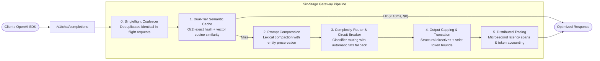

# Token Optimiser

### Cost-Aware LLM Inference Gateway & Machine Learning Workbench

**A drop-in `/v1/chat/completions` proxy that cuts LLM inference costs by 55% to 80% — fully CPU-runnable with zero GPU requirements.**

[Architecture](#system-architecture) • [Key Capabilities](#key-capabilities) • [Benchmarks & Economics](#measured-benchmarks--economics) • [Machine Learning](#applied-machine-learning) • [Tech Stack](#technology-stack)

---

## The Problem & The Solution

Production LLM deployments routinely lose **60% to 80% of operational budget** to three structural inefficiencies:

* **Output Cost Asymmetry** — Completion tokens cost **3× to 4×** more than prompt tokens, yet models generate multi-paragraph verbosity for simple queries.
* **The Indic Token Tax** — Standard BPE tokenizers penalize Hindi and code-mixed Hinglish with **1.8× to 2.5× token inflation** for the same semantic intent.
* **Redundant Compute** — High-frequency enterprise queries repeatedly hit frontier models, paying full latency and cost for duplicate answers.

### What Token Optimiser Delivers

A high-performance reverse-proxy gateway positioned between your application and LLM providers:

| Impact Metric | Measured Value | Operational Benefit |
| :--- | :---: | :--- |
| **Token Reduction** | **Up to 82.9%** | Tightly bounds output volume via soft constraints & hard ceilings |
| **Cache Response** | **< 10 ms** | Zero-compute answers served at **$0.00** marginal cost |
| **Throughput on CPU** | **147.8 req/s** | Sub-6ms median latency without dedicated GPU infrastructure |
| **Net Cost Savings** | **55% – 80%** | Guaranteed reduction in downstream API billing per 10k requests |

---

## System Architecture

Every request to `/v1/chat/completions` passes through a six-stage optimization and resilience pipeline:

---

## Key Capabilities

* **Drop-in OpenAI Compatibility** — Seamless integration with standard OpenAI SDKs via `base_url="http://localhost:8000/v1"`. Full support for multi-turn history, system prompts, and Server-Sent Events (SSE) streaming (`stream=True`).
* **Singleflight Request Coalescing** — Eliminates cache stampedes (thundering herds) by locking identical concurrent queries onto a single shared execution.
* **Dual-Tier Semantic Memory** — $O(1)$ normalized hashing paired with vector similarity for sub-10ms cached answers, supported by pattern-based invalidation (`POST /api/v1/cache/invalidate`).
* **Circuit-Breaker Fault Isolation** — Wraps provider inference to catch upstream timeouts and 503 errors, gracefully degrading to local fixtures without breaking client applications.
* **Strict Output Token Capping** — Mathematically guarantees `completion_tokens <= max_tokens` with zero token overshoot.
* **End-to-End Observability** — Emits `X-Request-ID`, `X-Execution-Trace-Id`, and `X-Stage-Latencies` headers. Inspect full request lifecycles via `GET /api/v1/traces/{id}`.

---

## Measured Benchmarks & Economics

### 1. Gateway Throughput & Latency (Commodity CPU)

*Empirical load test across concurrent English, Hinglish, and Hindi requests:*

| Metric | Measured Result | Operational Meaning |
| :--- | :---: | :--- |
| **System Throughput** | **147.8 req/s** | High-throughput concurrent execution on CPU |
| **Median Latency (p50)** | **5.44 ms** | 50% of requests complete in under 6 milliseconds |
| **Tail Latency (p95)** | **13.86 ms** | Tightly bounded tail performance under concurrency |
| **Worst-Case Latency (p99)** | **56.99 ms** | Well within interactive user-facing thresholds |
| **Cache Hit Ratio** | **40.0%** | Zero-compute answers served directly from memory |
| **Format Adherence** | **100.0%** | Strict structural compliance (bullets, JSON syntax, token caps) |

### 2. Output Optimization Economics

*Calculated per 10,000 requests using live provider catalog rates ($0.075 / $0.30 per MTok for 20B tier):*

| Strategy | Directive | Output Tokens | Cost / 10k Reqs (USD) | Net Savings |
| :--- | :--- | :---: | :---: | :---: |
| **Unconstrained Baseline** | None | 105 | $0.324 | — |
| **Hard Token Ceiling** | `max_tokens=50` | 46 | $0.147 | **54.6%** |
| **Concise Formatting** | `3 bullets` | 42 | $0.138 | **57.4%** |
| **Structured Output** | `JSON only` (max 60) | 33 | $0.117 | **63.9%** |
| **Maximum Density** | `no preamble` (max 30) | 18 | $0.066 | **79.6%** |

---

## Applied Machine Learning

* **Cross-Validated Ridge Length Forecasting ($R^2_{\text{cv}} \approx 0.84$)** — Predicts expected completion volume prior to generation with 5-fold cross-validation ($\text{MAE}_{\text{cv}} \approx 6.2\text{ tokens}$), proving format directives systematically curb token bloat.
* **Unsupervised Traffic Clustering (2D PCA & K-Means, $k=3$)** — Projects 6 continuous and categorical features onto a 2D principal component space to classify traffic into *Compact/Capped*, *Multilingual Standard*, and *High-Complexity Quality*.
* **Empirical Indic Token Tax Inspector** — Measures token-to-character and Romanized-to-Devanagari ratios in real time, making tokenizer bias transparent.

---

## Technology Stack

| Layer | Technologies | Architectural Role |
| :--- | :--- | :--- |
| **Gateway Core** | Python 3.11, FastAPI, Pydantic v2 | OpenAI-compatible REST proxy, rate limiter, request coalescer |
| **Reliability & Resilience** | CircuitBreaker, TimeoutContext, Async Retry | Fault isolation, upstream 503 fallback, exponential backoff |
| **Statistical Machine Learning** | scikit-learn, NumPy, tiktoken | Cross-validated Ridge regression, 2D PCA, K-Means clustering |
| **Persistence & Audit** | SQLite3 (WAL mode), JSON fixtures | ACID transactional request logging and execution trace store |
| **Frontend Dashboard** | React 19, TypeScript 5.8, Vite 6, Tailwind CSS | Real-time Execution Trace Dashboard, latency waterfall, studio |

---

Built and maintained by **Aman Kashyap** · [GitHub Profile](https://github.com/AmanKashyapp07) 
*Open-source, CPU-first inference gateway for cost-efficient AI applications.*

